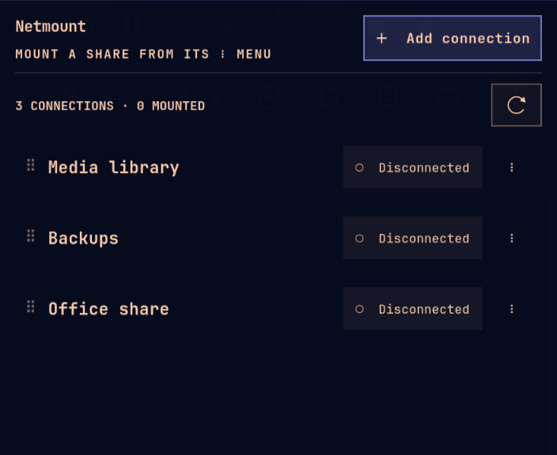

# Omarchy Netmount

Mount SMB/CIFS network shares (NAS, Samba, Windows) from the Omarchy bar. Saved connections, optional logins in GNOME Keyring, one-click mount and unmount.



## Install

Install the dependencies:

```sh
sudo pacman -S --needed cifs-utils python-gobject gtk3 libsecret gnome-keyring
```

Most of these packages already ship with Omarchy. Then add the plugin:

```sh
omarchy plugin add https://github.com/hnry047/omarchy-netmount.git --enable
```

Requires Omarchy with plugin support (Hyprland Lua config). Update with `omarchy plugin update hnry047.netmount`. If the icon doesn't appear, run `omarchy restart shell`.

## Use

Click the bar icon, then **Add connection**:

| Field        | Example                                      |
| ------------ | -------------------------------------------- |
| Server       | `192.0.2.10`, `fileserver` or `\\fileserver` |
| Remote share | `shared` or `shared/documents`               |
| Local folder | `/mnt/nas-shared` (under `/mnt`, `/media` or `~`) |

Click **Save and mount**. Use the ⋮ menu to Mount, Disconnect, Edit or Forget.

## Security

- SMB 3 encryption and `noexec` are on by default (per-connection opt-outs under **Security**).
- Passwords never appear in command arguments, config files or logs.
- Only `mkdir`, `mount` and `umount` are elevated, through polkit. No sudo rules or fstab entries.
- It never unmounts a share it didn't mount.

## Uninstall

1. In the manager, **Disconnect** and **Forget** every connection. Do this first: only the manager can unmount shares and delete saved logins.
2. Remove the plugin and its data:

```sh
omarchy plugin remove hnry047.netmount
rm -r ~/.config/omarchy-netmount ~/.local/state/omarchy-netmount
```

If shares are still mounted after that, unmount them with `sudo umount <folder>` and clear saved logins with `secret-tool clear xdg:schema org.omarchy.Netmount`.

## Development

Clone the repo and run `/usr/bin/python3 install.py` to link it as the installed plugin. Tests live in `tests/`; `test_gtk_ui`, `test_live_geometry` and `test_scratchpad` open real windows on your desktop. To release, bump `"version"` in `manifest.json` and push to `main`.

## License

MIT. See [LICENSE](LICENSE).
